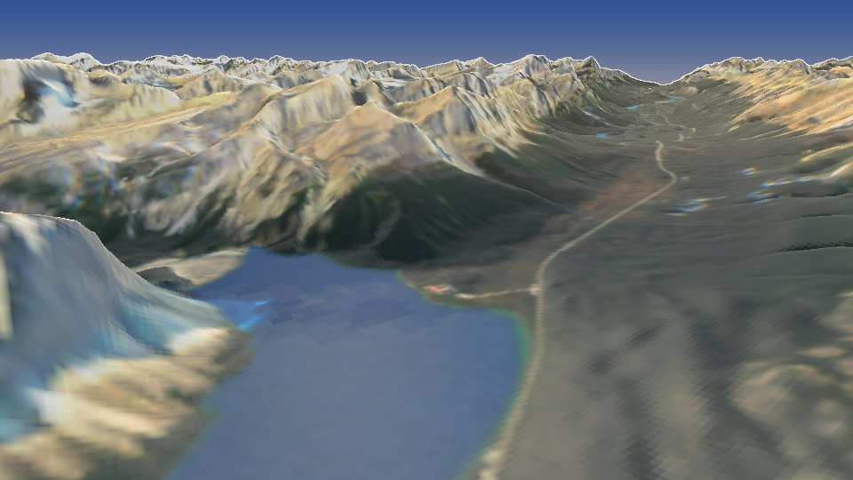

# Icefields Parkway flyover



A flight up the Icefields Parkway in the Canadian Rockies on a late-September evening, rendered with [forge3d](https://github.com/milos-agathon/forge3d) 1.40.1:

1. It starts over Lake Louise, looking up the lake to the Victoria Glacier.
2. It climbs north up the Bow Valley, past the Crowfoot Glacier and Bow Lake.
3. It pauses at Bow Summit for the classic view down Peyto Lake.
4. It runs down the Mistaya to Saskatchewan Crossing, and up the North Saskatchewan to Sunwapta Pass.
5. It settles over the Columbia Icefield and the Athabasca Glacier.

## Run it

```powershell
pixi install
pixi run data       # ~1 GB the first time: Copernicus DEM tiles + Sentinel-2 imagery, both on AWS
pixi run prep
pixi run path       # the flight drawn on a map -> out\flight_map.png
pixi run stills     # a few full-size frames along the way
pixi run render     # the whole flight, 1920x1080 at 30 fps -> out\icefields_parkway_flyover.mp4
```

To change the flight, edit `KEYS` in `scripts/flight.py`.

## The notebook

**[notebooks/icefields.ipynb](notebooks/icefields.ipynb)** walks through how this is made, using the project's own scripts: the Copernicus terrain and what the viewer meshes, the Sentinel-2 imagery with the lake and cliff fixes (Peyto Lake before and after), the flight with its speed, lens and clearance, why this scene drops the shadow map, and four frames from Lake Louise to the Columbia Icefield. It's saved with its outputs, so it reads on GitHub without running anything.

To run it yourself: `pixi run data` and `pixi run prep` first. Sections 1–4 need no renderer; section 5 opens the forge3d viewer (a GPU, or on Linux Mesa's software Vulkan under `xvfb-run`). It also needs matplotlib and Jupyter, which aren't in this project's pixi environment.

## Data

- **Terrain:** Copernicus GLO-30 DEM (ESA / Copernicus Programme, via the AWS open-data bucket), reprojected to 25 m in UTM 11N.
- **Imagery:** Sentinel-2 Level-2A true colour (ESA Copernicus), via Element 84's Earth Search. It comes from the nearly cloud-free pass of September 25, 2025, with any gaps filled from other late-summer passes using the scene classification.
- **Sun:** placed for September 25, 2025 at 5:45 pm MDT.
